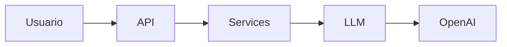

# thepower-chatbot-cudavezmas

Aplicación web de atención al cliente para **CUDA Vez Más**, una tienda online. El usuario escribe en el navegador y el asistente responde en español sobre pedidos, envíos, devoluciones, cambios y atención al cliente.

El asistente no consulta compras reales. Si preguntan por un pedido concreto, explica que todavía no hay conexión con la base de datos de pedidos y no inventa números de seguimiento ni estados.

## Objetivo de la actividad

Construir el chatbot por capas, de forma que cada parte tenga una sola responsabilidad:

- la interfaz solo habla con la API;
- la API solo valida la petición HTTP y devuelve JSON;
- el servicio define el comportamiento del asistente;
- la capa LLM es la única que llama a OpenAI;
- la configuración lee las variables de entorno y no muestra la clave.

Así se puede entender el recorrido de un mensaje sin mezclar Flask, la lógica de la tienda y el SDK de OpenAI en el mismo archivo.

## Arquitectura por capas

```text
Usuario → API → Services → LLM → OpenAI
```



1. El usuario escribe en `templates/index.html` y el navegador envía `POST /api/chat`.
2. `api/routes.py` comprueba que el JSON incluye un `message` no vacío.
3. `services/chatbot_service.py` añade las instrucciones de atención al cliente.
4. `llm/openai_client.py` llama a la API Responses de OpenAI con la clave y el modelo de `config/settings.py`.
5. El texto generado vuelve por el mismo camino hasta el navegador.

La interfaz y el servicio no usan el SDK de OpenAI. La clave no se escribe en el código ni en el HTML.

## Carpetas

| Carpeta | Para qué sirve |
| --- | --- |
| `api/` | Rutas HTTP. Expone `POST /api/chat` y devuelve la respuesta o un error con su código HTTP. |
| `services/` | Lógica del asistente: tono, idioma y reglas sobre pedidos, envíos, devoluciones y cambios. |
| `llm/` | Cliente de OpenAI. Envía el mensaje y devuelve el texto generado. |
| `config/` | Carga `.env` con `python-dotenv` y publica `OPENAI_API_KEY` y `OPENAI_MODEL`. |
| `templates/` | Página del chat. Muestra los mensajes del usuario y del asistente. |

`app.py`, en la raíz, crea la aplicación Flask, registra el blueprint y sirve `/`.

## Requisitos previos

- WSL con Ubuntu. Abre la terminal Ubuntu, no PowerShell.
- Python 3, `venv` y `pip`. Si faltan:

```bash
sudo apt update
sudo apt install -y python3 python3-venv python3-pip
```

- Conexión a internet para instalar dependencias y llamar a OpenAI.
- Una clave de API de OpenAI. No la compartas ni la subas a Git.

El entorno virtual de Windows no sirve en Ubuntu. Si ya existe una carpeta `.venv` creada fuera de WSL, bórrala antes de continuar.

## Instalación de dependencias

Sitúate en la carpeta del proyecto `thepower-chatbot-cudavezmas` dentro de Ubuntu y crea el entorno virtual de Linux:

```bash
cd thepower-chatbot-cudavezmas
```

Instala las dependencias:

```bash
rm -rf .venv
python3 -m venv .venv
source .venv/bin/activate
python -m pip install -r requirements.txt
```

El archivo `requirements.txt` instala Flask, el SDK oficial `openai` y `python-dotenv`. El prompt debe mostrar `(.venv)` antes de seguir.

## Configuración del archivo .env

Copia la plantilla y edítala. No subas el `.env` a Git: ya está ignorado.

```bash
cp .env.example .env
nano .env
```

Contenido:

```text
OPENAI_API_KEY=pon_aqui_tu_api_key
OPENAI_MODEL=gpt-6-luna
```

Sustituye `pon_aqui_tu_api_key` por tu clave real. Guarda con `Ctrl+O` y cierra nano con `Ctrl+X`. Si omites `OPENAI_MODEL`, la aplicación usa `gpt-6-luna`. Si falta `OPENAI_API_KEY`, el arranque o la petición fallan con un mensaje claro y sin mostrar la clave.

## Cómo ejecutar la aplicación

Con el entorno activado y el `.env` creado:

```bash
source .venv/bin/activate
python app.py
```

Abre [http://127.0.0.1:5000](http://127.0.0.1:5000) en el navegador de Windows. WSL redirige ese puerto. La aplicación escucha en el puerto 5000. Para pararla, pulsa `Ctrl+C` en la misma terminal de Ubuntu.

## Cómo probar el chatbot

En la página, escribe:

```text
¿Dónde está mi pedido?
```

Pulsa **Enviar** o Enter. La interfaz llama a `POST /api/chat` con este JSON:

```json
{"message": "¿Dónde está mi pedido?"}
```

La respuesta esperada debe decir, con un tono amable, que todavía no puede consultar ese pedido. No debe inventar un número de seguimiento ni un estado.

También puedes probar la API desde otra terminal de Ubuntu mientras `app.py` sigue en marcha:

```bash
curl -s -X POST http://127.0.0.1:5000/api/chat \
  -H "Content-Type: application/json; charset=utf-8" \
  -d '{"message":"¿Dónde está mi pedido?"}'
```

## Base de datos de pedidos

Todavía no existe conexión con una base de datos real de pedidos. El asistente solo puede responder de forma general. Ante una consulta concreta, como un número de pedido o un seguimiento, debe explicar esa limitación en lugar de simular que ha consultado la compra.
